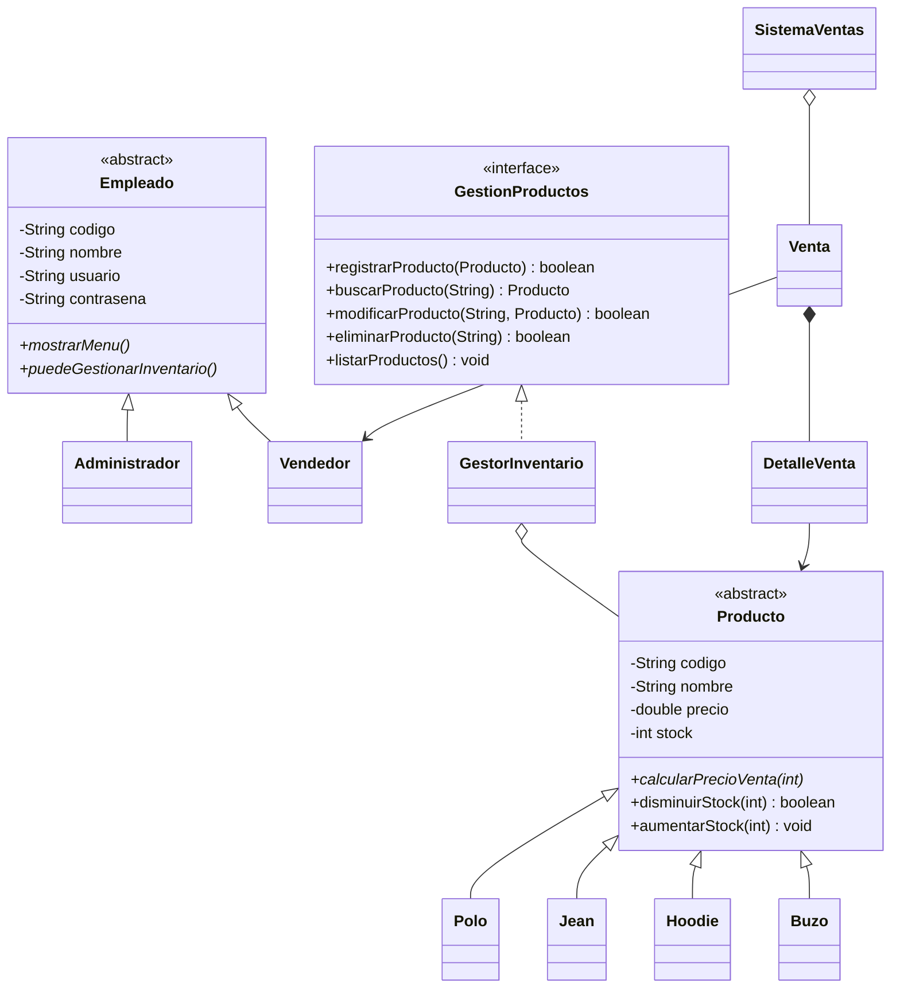

# Nonconformist — Sistema de ventas e inventario en Java

## Requisitos
- Java 8 o superior.
- Proyecto de consola; no requiere librerías externas.

## Cómo ejecutar
Desde la carpeta `src`, compila todos los archivos:

```bash
javac *.java
java Main
```

En IntelliJ IDEA, abre la carpeta `NonconformistJava`, marca `src` como Sources Root si hace falta y ejecuta `Main.java`.

## Usuarios de prueba
- Administrador: usuario `admin`, contraseña `admin123`
- Vendedor: usuario `venta`, contraseña `venta123`

## Reglas de negocio de ejemplo
Los porcentajes se definieron como reglas de demostración y pueden modificarse según lo que decida el grupo:
- Polo: 5 % de descuento al comprar 3 o más unidades.
- Jean: 10 % de descuento al comprar 2 o más unidades.
- Hoodie: 15 % de descuento al comprar 2 o más unidades.
- Buzo: 10 % de descuento al comprar 3 o más unidades.
- Comisión del vendedor: 5 % del total de la venta.

El precio total de cada línea se calcula de forma polimórfica llamando `calcularPrecioVenta(cantidad)` mediante una referencia `Producto`.

## Clases
- Abstractas: `Empleado`, `Producto`.
- Hijas: `Administrador`, `Vendedor`, `Polo`, `Jean`, `Hoodie`, `Buzo`.
- Interfaz: `GestionProductos`.
- Gestión de inventario: `GestorInventario`.
- Ventas: `DetalleVenta`, `Venta`, `SistemaVentas`.
- Ejecución: `Main`.

## UML en texto


## Nota para la entrega
Antes de presentar, revisen que las reglas de descuento sean aceptadas por el docente y que todos los integrantes puedan explicar las decisiones de diseño. Las contraseñas de prueba están en texto plano solo porque es un ejercicio introductorio de consola; no es una práctica adecuada para un sistema real.
